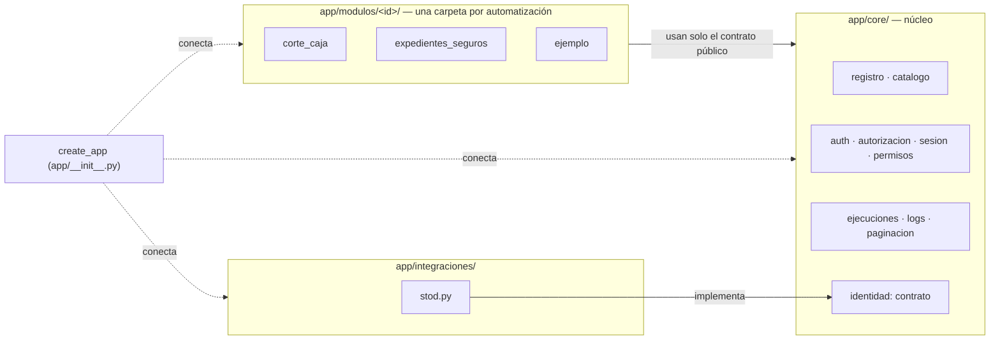
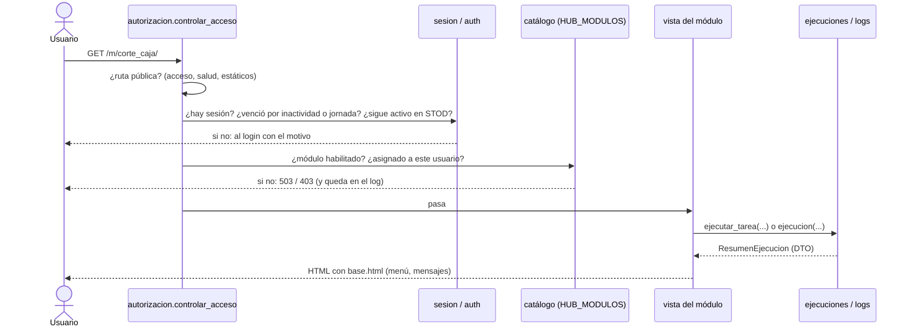

# Mapa del código de ORBIT Canella

Para ubicarse rápido: qué pasa en cada momento y en qué archivo. Las reglas y su porqué están en
[ARQUITECTURA.md](ARQUITECTURA.md); el paso a paso para crear un módulo, en
[AGREGAR_MODULO.md](AGREGAR_MODULO.md). Los diagramas usan Mermaid (GitHub los dibuja; en VS Code
hace falta una extensión de vista previa de Mermaid).

---

## 1. Las tres capas

`core` no importa ni `modulos` ni `integraciones`; un módulo no importa otro módulo, ni nombra
sus tablas, variables, tareas, rutas o carpetas, ni registra ganchos que afecten a todo el hub.
Lo vigila `tests/test_arquitectura.py` (detalle en
[ARQUITECTURA.md, principio 7](ARQUITECTURA.md#7-convivencia-entre-módulos)).

---

## 2. Arranque: qué hace `create_app`

Archivo: `app/__init__.py`. Se ejecuta con `flask --app wsgi run` (desarrollo) o `serve.py`
(Waitress).

| Paso | Qué hace | Dónde |
|---|---|---|
| 1 | Carga `.env` y elige la configuración por `AUTOMATE_ENV` | `app/config.py` |
| 2 | Logging central a `logs/automate-AAAA-MM-DD.jsonl` | `app/core/logs.py` |
| 3 | Base de datos, migraciones (con filtro que nunca borra tablas ajenas), CSRF, login | `app/extensions.py`, `app/core/migraciones.py` |
| 4 | Blueprints del núcleo: acceso, inicio, administración | `core/auth.py`, `core/hub.py`, `core/admin.py` |
| 5 | Autorización central (`before_request`) y cabeceras de seguridad (CSP) | `core/autorizacion.py`, `core/seguridad.py` |
| 6 | Comandos de consola del núcleo | `core/cli.py` |
| 7 | Proveedor de identidad: STOD (o el simulado en pruebas) | `integraciones/stod.py` |
| 8 | **Descubre los módulos**: importa cada `app/modulos/<id>/` y registra su `MODULO`; monta su Blueprint en `/m/<id>` | `core/registro.py` |
| 9 | Sincroniza el catálogo (tabla `HUB_MODULOS`) con los módulos del código | `core/catalogo.py` |
| 10 | Marca como `interrumpida` lo que quedó `en_curso` de un arranque anterior | `core/ejecuciones.py` |

Si un módulo falla al importarse, queda en el log (`modulo.error_carga`) y el hub arranca igual.

---

## 3. Recorrido de una petición

| Momento | Archivo |
|---|---|
| Login contra STOD, bloqueo por intentos | `app/core/auth.py` |
| Vencimiento de sesión y aviso de 2 min | `app/core/sesion.py`, `app/static/js/sesion.js` |
| Quién entra a qué (admin, superadmin, módulo) | `app/core/autorizacion.py` |
| Acciones de un módulo solo para administradores | `app/core/permisos.py` (`@solo_administradores`) |
| Error no controlado → rollback, log y página 500 | `_instalar_errores` en `app/__init__.py` |

Ocultar un enlace del menú no autoriza nada: la verificación es siempre en el servidor.

---

## 4. Ejecuciones y logs

Una **ejecución** es una corrida registrada de una tarea (web, consola o programada) en
`HUB_EJECUCIONES`. Mientras dura, todo log que se emita lleva su `ejecucion_id`.

| Quiero… | Uso |
|---|---|
| Correr una tarea del módulo desde una vista | `ejecutar_tarea("corte_caja", "procesar", usuario_id=...)` |
| Correrla sin sesión web (programada) | `flask --app wsgi tareas ejecutar corte_caja procesar --proceso nombre` |
| Envolver un bloque propio como ejecución | `with ejecucion(modulo, tarea=..., usuario_id=...) as ctx:` |
| Mostrar las últimas corridas | `ultimas_ejecuciones(modulo_id, limite=...)` |
| Escribir en el log del módulo | `log = get_logger("<id>")` |

Reglas de las tareas (sin `commit` dentro, efectos externos al final): ver
[ARQUITECTURA.md#atomicidad](ARQUITECTURA.md#atomicidad) y [EJECUCIONES.md](EJECUCIONES.md).
Consulta de logs: **Administración → Logs** o [LOGS.md](LOGS.md).

---

## 5. Dentro de un módulo

Todos siguen el mismo reparto de archivos; no todos los tienen todos.

| Archivo | Responsabilidad |
|---|---|
| `__init__.py` | `MODULO = DefinicionModulo(...)`: id, nombre, ícono, Blueprint, tareas. Lo único público |
| `views.py` | Rutas (Blueprint `bp`) |
| `reglas.py` | Reglas de negocio **puras** (sin base de datos ni red): lo más fácil de probar |
| `servicios.py` | Casos de uso: combina reglas, base de datos e integraciones |
| `models.py` | Tablas `<ID_MODULO>_*` |
| `configuracion.py` | Lee sus variables `<MODULO>_*` del `.env` al usarse (no al importar) |
| Adaptador externo | Contrato (`Protocol`) + implementación real: `buzon.py` (EWS), `sap.py` (SQL a SAP), `envio.py` (SMTP) |
| `cli.py` | Comandos `flask --app wsgi <id> <comando>` |
| `templates/<id>/`, `static/` | Pantallas (extienden `base.html`) y sus CSS/JS en `/m/<id>/static` |

### Módulos actuales

| Módulo | Qué hace | Entra por | Sale a | Guía |
|---|---|---|---|---|
| `corte_caja` | Archiva los cortes de caja que llegan por correo y rechaza los que no cumplen | Buzón Exchange (EWS, vía proxy) | Carpeta compartida + respuesta por correo | [PLAN_INTEGRACION_CORTE_DE_CAJA.md](PLAN_INTEGRACION_CORTE_DE_CAJA.md) |
| `expedientes_seguros` | Arma el paquete PDF de un reclamo para Cobros con páginas del expediente en SAP | SAP (SBO_CANELLA, solo lectura) + anexos en red | PDF en `instance/` + correo SMTP o `.eml` | [PLAN_EXPEDIENTES_SEGUROS.md](PLAN_EXPEDIENTES_SEGUROS.md) |
| `ejemplo` | Plantilla de referencia, sin datos contables | — | — | [AGREGAR_MODULO.md](AGREGAR_MODULO.md) |

---

## 6. Datos: dónde vive cada cosa

| Qué | Dónde | ¿En Git? |
|---|---|---|
| Tablas del núcleo | `HUB_*` en la base `AUTOMATE_CANELLA` (SQL Server) | Esquema sí (migraciones) |
| Tablas de cada módulo | `<ID_MODULO>_*` en la misma base | Esquema sí |
| Migraciones | `migrations/versions/` (una sola cadena para todo el hub) | Sí |
| Secretos y conexiones | `.env` (plantilla: `.env.example`) | **No** |
| Archivos que generan los módulos (PDF, miniaturas) | `instance/<id>/` — tienen datos personales | **No** |
| Logs | `logs/automate-AAAA-MM-DD.jsonl` | **No** |
| Material de levantamiento real (correos, expedientes) | `contexto/` | **No** |

---

## 7. Interfaz

| Qué | Dónde |
|---|---|
| Esqueleto HTML | `app/templates/base_layout.html` |
| Pantallas con menú (la que extienden los módulos) | `app/templates/base.html` |
| Login y errores sin sesión | `app/templates/base_publica.html` |
| Componentes reutilizables | `app/templates/_macros.html` |
| Estilos propios | `app/static/css/automate.css` (Tabler 1.5.1 local, sin CDN) |
| Spinners, confirmaciones y filas que abren su detalle (`data-cargando`, `data-confirmar`, `data-fila-enlace`) | `app/static/js/interaccion.js` |
| Menú que se oculta | `app/static/js/menu.js` |

Sin JavaScript en línea (lo prohíbe la CSP). Detalle en [INTERFAZ.md](INTERFAZ.md).

---

## 8. Pruebas

`python -m pytest` corre todo en segundos, con SQLite en memoria y STOD simulado: nunca toca la
base real. Un archivo por área (`tests/test_<area>.py`); las reglas de arquitectura están en
`tests/test_arquitectura.py`; el acceso de cada módulo, en `tests/test_contrato_modulos.py`. Ver
[PRUEBAS.md](PRUEBAS.md).
